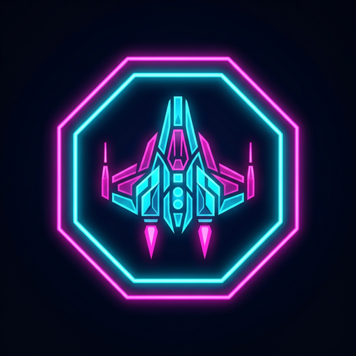

<div align="center">



# ⚡ NEON CORE

### Fast. Deterministic. Pure Rust.

**High-speed cyberpunk arena shooter for Android, Linux, and WebAssembly.**

Survive escalating enemy waves, customize your ship loadout, and push your reflexes in a zero-bloat arcade shooter built from scratch in Rust.

[](https://www.rust-lang.org/)
[](https://github.com/not-fl3/macroquad)
[](LICENSE)
[](https://github.com/vex2137/neon-core/actions)
[-green?logo=android)](https://github.com/vex2137/neon-core/actions)
[](https://github.com/vex2137/neon-core/actions)

**[Builds & Artifacts](https://github.com/vex2137/neon-core/actions) · [Features](#-features) · [Installation](#-installation) · [Documentation](#-documentation)**

</div>

---

## 🌟 What is NEON CORE?

**NEON CORE** is a fast-paced, top-down cyberpunk arcade survival shooter built in pure **Rust**.

Designed with a focus on responsiveness, deterministic simulation, and zero per-frame heap allocations in hot paths, NEON CORE runs natively across mobile, desktop, and browser targets without external asset bloat or heavy engine overhead.

### Why NEON CORE?

- 🚀 **Pure Rust** — Built natively with Macroquad 0.4 and zero `unsafe` blocks.
- ⚡ **High Performance** — Stack-allocated buffers, spatial hash grid collisions, and sub-30 µs simulation ticks.
- 📱 **Mobile-First Controls** — Dynamic multi-touch virtual sticks, High-DPI scaling, and Android 15 immersive fullscreen.
- 🔊 **Procedural Audio** — Real-time in-memory WAV PCM synthesis with zero external sound files.
- 💾 **Fault-Tolerant Saves** — Atomic writes, automatic `.bak` recovery, and 64-bit FNV-1a integrity checksums.
- 🎲 **Deterministic RNG** — Seeded XorShift64* simulation verified by automated regression tests.
- 💻 **Cross-Platform** — Native support for Android (ARM64), Linux (x86_64), and WebAssembly.
- ❤️ **Open Source** — Clean modular architecture across 31 focused modules.

---

## 📥 Builds & Platforms

Latest automated builds are generated via GitHub Actions on every push:

| Platform | Architecture / Target | Artifact |
|---|---|---|
| 🤖 Android | ARM64 (`aarch64-linux-android`, API 26–35) | Release APK (`neon_core.apk`) |
| 🐧 Linux | `x86_64` | Native Binary (`neon_core`) |
| 🌐 Web | `wasm32-unknown-unknown` | WebAssembly Demo (`neon_core.wasm`) |

**[View CI Builds & Artifacts](https://github.com/vex2137/neon-core/actions)** · **[View Releases](https://github.com/vex2137/neon-core/releases)**

---

## ✨ Features

### 🚀 Ships & Loadouts

Choose from three distinct playable ships, each with unique base stats and playstyles:

- **Vanguard** — Balanced speed, hull integrity, and weapon output.
- **Phantom** — High-mobility interceptor that drops tactical mines when dashing.
- **Titan** — Heavy assault frame built for sustained firepower and durability.

### 👾 Enemies, Bosses & Wave Events

- **7 Enemy Archetypes** — *Chaser*, *Runner*, *Shooter*, *Tank*, *Splitter*, *Sniper*, and multi-phase wave *Bosses*.
- **Elite Variants** — Escalating modifiers with boosted stats and higher shard rewards.
- **Dynamic Arena Events** — Orbital hazards and *Overload Beacon* capture objectives.

### ⚔️ Weapons & Progression

- **Tactical Arsenal** — Primary salvos, invulnerability Dash, Orbital Saws, EMP Nova, and Chain Tesla.
- **In-Run Draft System** — Choose from 3 randomized upgrades on every level-up.
- **Persistent Hangar Shop** — Spend collected shards on permanent ship and stat upgrades.

### 📱 Android 15 & High-DPI Ergonomics

- **Adaptive Virtual Viewport** — Scales cleanly to high-DPI mobile screens (`540p` logical viewport with safe-area padding).
- **Immersive Fullscreen** — Native `WindowInsetsController` integration hiding status and navigation bars on Android 11–15.
- **Touch Controls** — Dynamic or fixed left movement stick, right aim stick / auto-aim toggle, and enlarged Dash button with cooldown arc.
- **Lifecycle Auto-Pause** — JNI `onPause` / focus-loss hook automatically pauses active runs when switching apps.

### 📊 Performance & Diagnostics

Built for consistent 60+ FPS even during dense bullet-hell waves:

- **Spatial Hash Grid** — Fixed-capacity intrusive linked-list grid (`27×27` cells, **18.09× faster** than linear scans).
- **Zero-Alloc Hot Paths** — Stack-allocated `TextBuf<N>` formatting and polygon buffers with zero per-frame heap allocations.
- **Heavy Combat Benchmark** — **27.0 µs/frame** average across 300 active enemies and 120 projectiles (`0.16%` of a 60 FPS frame budget).
- **Built-in Perf HUD** — Toggleable 120-frame rolling FPS, average/peak frame time, and entity counter overlay.

---

## 🎮 Controls

| Action | Desktop | Android / Touch |
| :--- | :--- | :--- |
| **Move** | `W A S D` / `Arrow Keys` | Left Virtual Joystick *(Dynamic or Fixed)* |
| **Aim / Fire** | Mouse / Auto-Aim | Right Virtual Stick / Auto-Aim |
| **Dash** | `Space` / `Shift` | Bottom-Right `DASH` Button |
| **Pause** | `Esc` / `P` | Top-Right Pause Button *(or app background)* |

---

## 🛠️ Installation & Running

### 🤖 Android

**Requirements**
- Android 8.0 or newer (API 26–35).
- ARM64 device.

**Steps**

1. Download the `neon_core` APK artifact from **[GitHub Actions](https://github.com/vex2137/neon-core/actions)** (or Releases).
2. Open the APK on your Android device.
3. Allow installation from your browser or file manager if prompted.
4. Launch **NEON CORE**.

> **Note:** If upgrading from an older debug build with a different signing key, uninstall the previous version first.

### 🐧 Linux

**Requirements**
- Linux `x86_64` with OpenGL / X11 or Wayland libraries.
- Rust toolchain (`cargo`) if building from source.

**Run from Source**

```bash
git clone [https://github.com/vex2137/neon-core.git](https://github.com/vex2137/neon-core.git)
cd neon-core
cargo run --release
